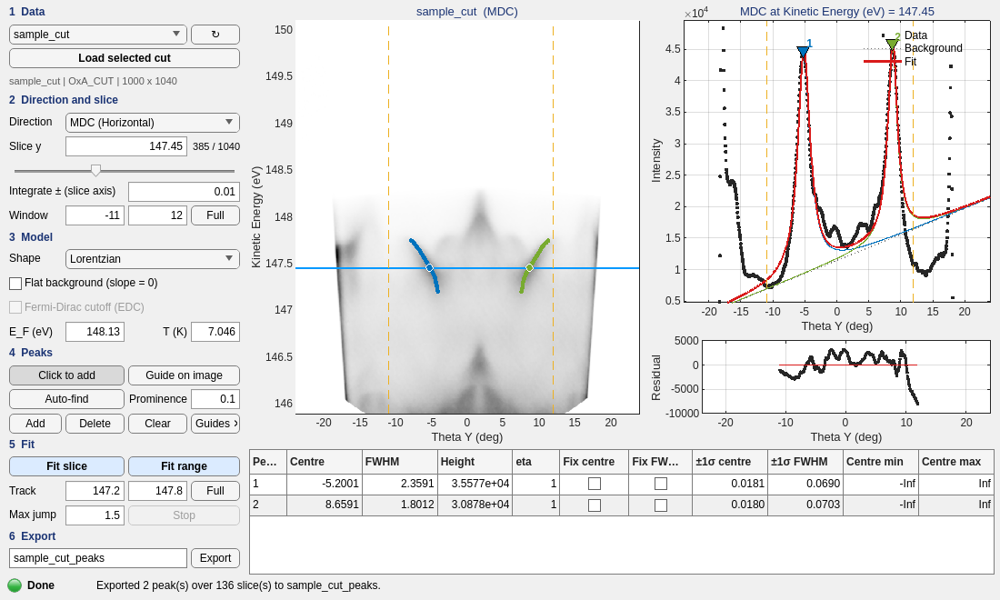
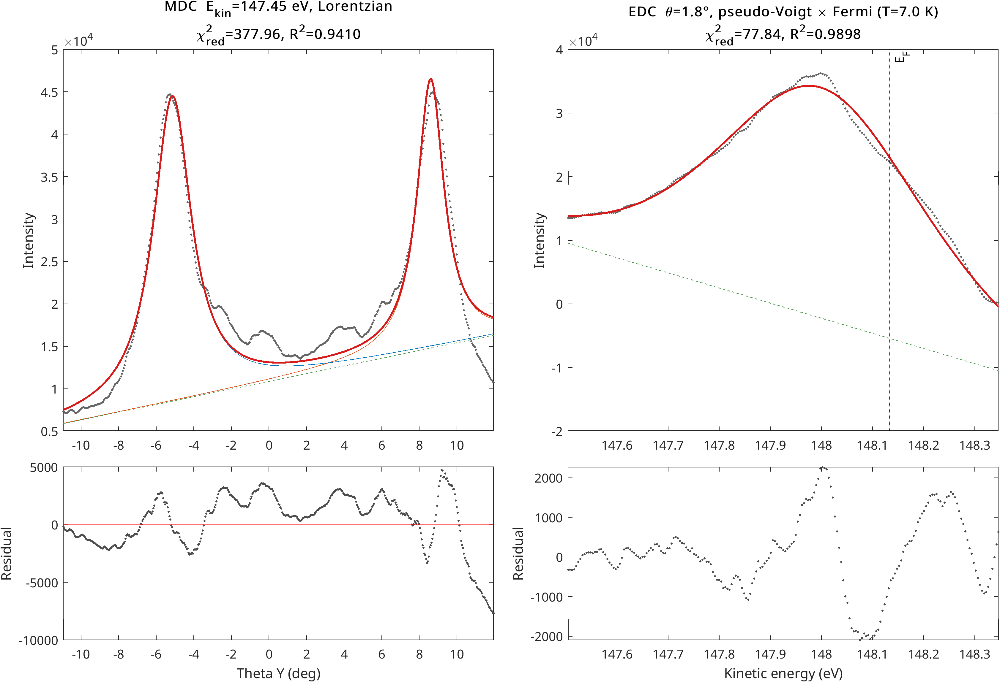

# PeakFit user guide

`PeakFit_app` fits peaks in MDCs and EDCs of a 2-D ARPES cut. It replaces the
**Fit MDC** menu entry (`fit_MDC_demo_20150312`), which stays in
`Fitting/fit_MDC_demo/` unchanged. Code: `Fitting/PeakFit/` (`PeakFit_app.m`
and the `pkf_*` backend). Base MATLAB only (R2023a tested; no Curve Fitting,
Optimization, Signal Processing or Image Processing Toolbox).



## Opening it

- Browser v5: **Analyze → Fit spectra → Fit Peaks (MDC/EDC)**.
- Legacy v32: **Tools → Fit Peaks (MDC/EDC)**.
- Command line: `app = PeakFit_app;` (empty), `PeakFit_app('name')` for a
  base-workspace variable, or `PeakFit_app(data)` for a struct/`OxA_CUT`.

From a browser, the first selected variable that is a valid 2-D cut is loaded;
otherwise the window opens empty with a note in the status bar. Only 2-D cuts
(`value` of size `numel(x) × numel(y)`) are accepted. Maps and other 3-D/4-D
data are refused with "2D cuts only; extract a 2D slice first". The source
variable is read once and is never modified.

## Workflow (left column, top to bottom)

1. **Data** – choose a cut and press **Load selected cut** (↻ refreshes the list).
2. **Direction and slice** – **MDC** (horizontal: profile along x at a fixed y)
   or **EDC** (vertical: profile along y at a fixed x). Set the slice by value,
   slider or by clicking the image; **Integrate ±** averages neighbouring
   slices within that half-width; **Window** crops the profile used in the fit
   (**Full** resets it).
3. **Model** – **Shape**: Lorentzian, Gaussian or Pseudo-Voigt
   (`height·(η·L + (1−η)·G)`, shared FWHM, η free in [0, 1]). Default is
   Lorentzian for MDCs and Pseudo-Voigt for EDCs. The background is linear;
   **Flat background** holds the slope at 0.
   **Fermi-Dirac cutoff (EDC)** (off by default) multiplies peaks and
   background by a Fermi function with E_F and T held fixed. T is filled from
   `info.temperature`; E_F defaults to 0 when the energy axis spans 0
   (binding energy), else to `photon_energy − workfunction` when that lies on
   the axis (kinetic energy). Both fields can be edited. Without the cutoff,
   crop the window below E_F instead.
4. **Peaks** – with **Click to add** on, click on the profile to add a peak;
   drag a peak marker (▼) to move its centre and height. **Auto-find** replaces
   the peak set with local maxima above **Prominence** (fraction of the
   profile range). **Add** puts a peak at the largest residual; **Delete**
   removes the selected table row; **Clear** removes all. FWHM, height, η,
   bounds and fixed flags are edited in the table at the bottom.
   **Guide on image**: click along a band on the image to guide the selected
   peak during tracking (guides are pchip-interpolated; **Guides ×** clears).
5. **Fit** – **Fit slice** fits the current profile. **Fit range** fits every
   slice between **Track** from/to, walking both ways from the current slice;
   each slice starts from its neighbour's accepted fit. A slice is rejected
   when a centre jumps by more than **Max jump** × FWHM; tracking stops after 5
   consecutive rejections in a direction. **Stop** interrupts a run. The lamp
   shows Idle, Fitting…, Done or Failed.
6. **Export** – writes a NEW base-workspace variable (default
   `<source>_peaks`); it asks before replacing an existing variable and never
   writes over the source.

The centre panel shows the cut with the slice, window, seeds, tracked
dispersions and rejected points (×). The right panels show the profile with
data, components, background and fit, and the residual.

## Fitter

Bounded Levenberg–Marquardt (box-clamped, base MATLAB). Bounds: centre in the
window and in the per-peak [min, max]; FWHM in [step/2, 2·span]; height ≥ 0;
η ∈ [0, 1]. Uncertainties are ±1σ from the Jacobian covariance scaled by the
residual variance, so they are meaningful without absolute count errors.
χ²_red is reported with unit weights (GUI) or Poisson weights
(`'Weights','poisson'` from code); it is a relative quality measure unless the
intensities are raw counts. R² is also reported. NaN points are ignored.

## Exported structure

| Field | Meaning |
|---|---|
| `source_name`, `source_class` | Source variable and class |
| `direction`, `model`, `flat_background`, `fermi` | Settings used |
| `slice_axis`, `profile_axis`, `slice_values`, `integration_halfwidth`, `window` | Geometry |
| `background.c0/c1/err_c0/err_c1` | Linear background `c0 + c1·(u − window centre)` per slice |
| `chi2_red`, `r2`, `ok` | Per-slice fit quality |
| `peaks(k).x`, `.y` | Data-axis coordinates (as for `EmassFitting`) |
| `peaks(k).slice`, `.centre`, `.fwhm`, `.height`, `.eta`, `.err.*`, `.valid` | Per-peak results and ±1σ |
| `x`, `y` | Copies of peak 1, for the legacy one-peak workflow |
| `units`, `created` | Axis units and time stamp |

MDC: `x` = fitted centre, `y` = slice energy. EDC: `x` = slice momentum/angle,
`y` = fitted centre energy. Widths are FWHM (the old tool stored the half
width `w`). Only accepted slices enter `x`, `y` and the per-peak vectors.

## Scripting

```matlab
app = PeakFit_app('sample_cut');
app.setDirection('EDC'); app.setSlice(1.8); app.setIntegration(0.3);
app.setWindow([147.5 148.35]); app.setFermi(true);       % E_F, T prefilled
app.autoFindPeaks('Prominence', 0.1);
R = app.fitCurrentSlice();
T = app.fitRange([-5 5], 'MaxJump', 1.5);
name = app.exportPeaks();                                % sample_cut_peaks
s = app.getState();                                      % s.fitStatus etc.
```

The same backend works without the GUI:

```matlab
D = pkf_input(sample_cut, 'sample_cut');
[u, I] = pkf_extract_profile(D, 'MDC', 147.45, 0.01);
c = pkf_find_peaks(u, I, 'Prominence', 0.1, 'Window', [-11 12]);
R = pkf_fit_profile(u, I, struct('centre', num2cell(c)), 'Shape', 'Lorentzian', 'Window', [-11 12]);
T = pkf_track(D, R.peaks, 'Direction', 'MDC', 'Start', 147.45, 'Range', [147.2 147.75], 'Window', [-11 12]);
S = pkf_export(T, D);
```



*Example (measured i05 cut, θ vs kinetic energy): left, Lorentzian MDC with two
peaks; right, pseudo-Voigt EDC with the Fermi-Dirac cutoff at E_F = hν − φ and
T = 7.0 K; residuals below.*
