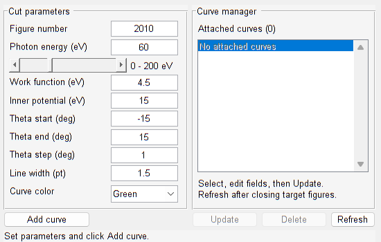

# kz_plot: Interface Improvements and Review

**Updated:** 16 November 2026

**Files:** `Visualization/kz_plot.m`, `Visualization/kz_plot.fig`, `Visualization/kz_plot_build_layout.m`

## Purpose and calculation

This GUIDE singleton draws calculated photon-energy cuts over an existing figure, complementing the Plot BZ workflow in the manual. It does not convert measured data. The horizontal coordinate is kz and the vertical coordinate is kx, both in inverse angstroms.

The free-electron final-state model at the Fermi level uses:

```text
Ekin = photonEnergy - workFunction                       [eV]
kx   = 0.512316722 sqrt(Ekin) sin(theta)                  [angstrom^-1]
kz   = 0.512316722 sqrt(Ekin cos(theta)^2 + innerPotential)
```

MATLAB degree-based trigonometric functions implement these equations. The perpendicular energy uses cosd(theta).^2 directly, avoiding the old tangent expression's singularities. Binding energy, photon momentum, and sample alignment offsets are not included. Interpretation depends on the experiment's angle convention and chosen inner potential.

## Current interface



| Setting, in display order | Default | Meaning |
|---|---:|---|
| Figure number | 2010 | Target figure; existing current axes receive the overlay. |
| Photon energy | 60 eV | Numeric entry synchronized with the slider beneath it. |
| Work function | 4.5 eV | Subtracted from photon energy. |
| Inner potential | 15 eV | Perpendicular-energy offset. |
| Theta start | -15 deg | First emission angle. |
| Theta end | 15 deg | Last emission angle. |
| Theta step | 1 deg | Positive angular sampling interval. |
| Line width | 1.5 pt | Editable curve width. |
| Curve color | Green | Green, blue, orange, purple, or black. |

The window is 440 by 280 MATLAB pixels, half its previous width and height. Margins and row spacing are reduced, and controls use 8-point text. The compact **Update** and **Delete** buttons act on the selected list entry; tooltips explain their actions. List rows use the compact format `F2010 | 60 eV | -15:1:15`.

The slider initially spans 0-200 eV, with both small and large steps set to 1 eV. Dragging snaps to whole eV values. Typing a higher energy expands its range while retaining 1 eV increments. Moving it changes the input field; **Update** applies the value to an existing curve. Numeric entry still permits fractional photon energies.

Theta step replaces fixed 100-point sampling. Ascending and descending intervals are supported. The final endpoint is included, with a shorter last interval if necessary. The default -15:1:15 interval has 31 samples. Equal endpoints produce one sample.

## Managing overlays

1. Choose parameters and click **Add curve** to add a line and photon-energy label.
2. The right panel lists managed curves across open figures and shows their count. Rows show figure number, energy, and theta sampling.
3. Select a row to load its parameters. Edit values, color, or width, then choose **Update**. This changes the existing line and label. Changing the figure number moves both into that target figure.
4. **Delete** removes only that curve and its label, preserving unrelated graphics.
5. Use **Refresh** after closing target figures or deleting lines externally. Direct deletion of a managed line also deletes its label.

Parameters and label handles are stored as kzPlotParameters appdata on tagged kz_plot_curve lines. Reopening the panel recovers these overlays while their target figures remain open. Older untagged curves from the previous implementation are not adopted automatically. No separate session file is written.

Existing axes retain their view and NextPlot state. New target axes autoscale around the curve, correcting the old behavior that restored empty default [0,1] limits and could hide a valid overlay.

## Implementation and maintenance

The GUIDE entry point and singleton dispatch remain. Named helpers separate input parsing, angle sampling, calculation, list discovery, selection, and graphics updates. Unused generated callbacks were removed; the rebuilt .fig binds controls to the implemented actions.

The .fig contains the complete interface and can be inspected in GUIDE. The developer utility kz_plot_build_layout recreates it with original figure metadata and no runtime curve state; normal launching does not require running this utility. It overwrites the saved layout, so future layout edits should also be reflected there if it remains the layout definition.

Input parsing uses str2double. It rejects nonfinite or complex values, invalid figure numbers, targeting this control panel, negative work function, photon energy below work function, nonpositive step/width, excessive sample counts, and non-real kz before changing graphics.

An earlier annotation pass saved the figure with Visible='off', causing direct launch to return a hidden window. This was corrected to Visible='on'. The layout utility explicitly sets this before saving to prevent recurrence.

## Verification

MATLAB R2024a Code Analyzer reports **0 issues** for both MATLAB files. A fresh launch produced a visible initialized interface. A captured window image was inspected for clipping and overlap.

Runtime checks exercised the actual saved UI callbacks with an isolated target figure:

- Requested defaults and 31 samples for the default theta interval.
- Adding two curves and updating a selected curve without duplication.
- Slider/field synchronization and range expansion to 250 eV.
- Descending theta sampling, alternate color, and selection parameter loading.
- Recovery of both curves after closing and reopening the panel.
- Deleting only the selected line and label.
- Preserving an unrelated line and explicit axes limits.
- Preserving an existing automatically scaled view, including when adding a new overlay.
- Including a shorter final theta interval and moving a selected line and label to another target figure.
- Removing closed-target entries on Refresh.

Following the compact-layout change, a fresh launch confirmed the 440 by 280 window size. Slider checks confirmed 1 eV arrow/track increments before and after range expansion to 250 eV, plus integer snapping when dragging. The refreshed screenshot was inspected; labels and controls fit without overlap. Both MATLAB files still have zero Code Analyzer findings.

These checks passed; the isolated target figure was deleted afterwards. They validate GUI mechanics and state handling. Experimental-data comparison and beamline-specific physical conventions were not assessed in this change.

## Background

- Manual/Manual.md: Brillouin zone and KZ plot.
- doc/PlotSlices_review.md: photon energy, work function, and KZ data context.
- doc/plotBZ_V1_review.md: reciprocal-space overlay conventions.
