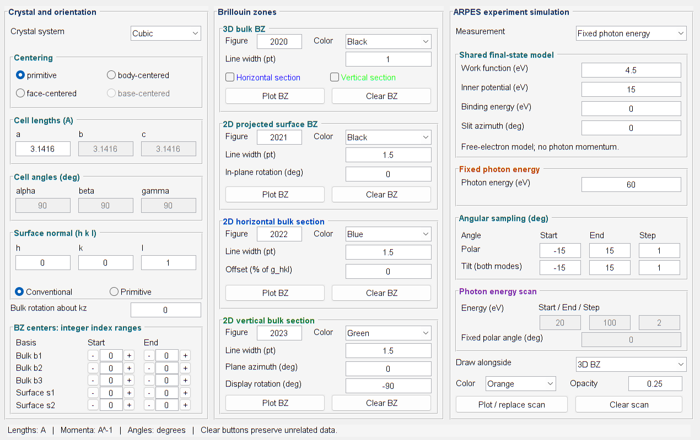
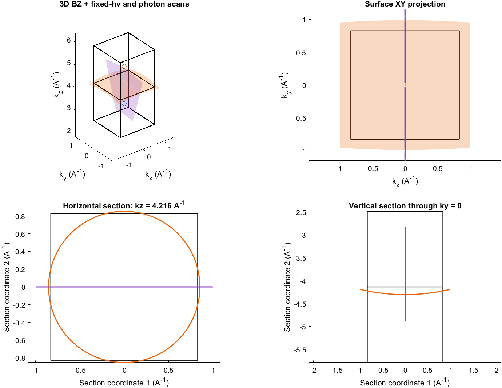
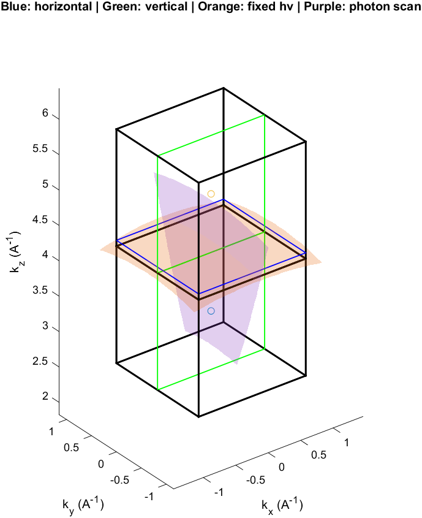

# plotBZ_V1 improvement log

Date: 17 November 2026.

## Scope and plan

Read `plotBZ_V1_review.md` and `kz_plot_review.md` (the requested paths were
written with an extra directory separator before `.md`). Preserve the previous
primitive surface basis, validated reciprocal geometry, adaptive Voronoi
padding, and tagged BZ graphics while improving the interface and simulation.

1. Rebuild the saved GUIDE interface in three aligned columns: crystal and
   orientation, BZ plotting, and ARPES simulation. Remove generated dead callbacks.
2. Trace the b1/b2/b3/s1/s2 display controls; remove them if output-only while
   retaining the numerical vectors used by the geometry.
3. Implement fixed-photon-energy and photon-energy-scan free-electron surfaces,
   referencing the local `OX_ARPES_AI/BZ_Plotter` implementation. Support 3D,
   projected surface BZ, and true horizontal/vertical section overlays.
4. Review numerical conventions, validation, graphics ownership, and code style;
   run regression/integration checks and inspect captured UI and plot images.
5. Build `AI_skills/arpes-plot-bz` with a scriptable MATLAB helper and validated
   examples, recording skill progress separately in `AI_skills/session_summary.md`.

## Initial inspection

- Working tree initially contained a pre-existing modification to `README.md`;
  preserve it. No applicable AGENTS.md was found in either checkout or ancestors.
- Previous geometry improvements and six regression tests are present.
- The five vector displays are written by the bulk/surface rotation helpers;
  downstream geometry uses their returned numeric arrays rather than those texts.
- MATLAB live session is R2024a; bundled matGeom is available on its path.
- Initial MCP static analysis of the legacy main file failed because its output
  was too large to parse. This matches the previous report's generated unused
  callback arguments. Analyze the cleaned implementation again after changes.
- Delegation: GUI/callback cleanup, numerical simulation/overlay implementation,
  and AI skill/API implementation assigned to separate subagents. Primary agent
  handles integration, independent review, session execution, visual QA, and log.

## Completed implementation

- Rebuilt `Visualization/plotBZ_V1/plotBZ_V1.fig` as a 1016-by-640 MATLAB-pixel
  interface: crystal/orientation and index ranges; four BZ plot cards; ARPES
  simulation. `plotBZ_V1_build_layout.m` reproduces it for future maintenance.
  Normal launching still uses `plotBZ_V1`, with no builder call required.
- Removed the five computed-vector display fields and their write operations.
  The `bulk_realtime_vector` and `surface_realtime_vector` functions remain
  necessary: they return the rotated bulk and primitive surface bases. Bulk
  b1/b2/b3 and surface s1/s2 **integer index ranges** remain useful controls.
- Reduced the 1,933-line GUIDE main file to a shared callback/plotting
  implementation of about 290 lines. Removed dead callbacks and consolidated
  validation, sections, styling, and axes-state handling. Added 3D line width.
- Added `plotBZ_V1_rotation.m` and migrated every package rotation call. This
  preserves right-handed degree-based matrices without Phased Array System
  Toolbox. MATLAB dependency analysis now reports MATLAB only; the bundled
  matGeom source remains an explicit path requirement.
- Added `plotBZ_V1_arpes_surface.m` for validated, independently callable scan
  calculations, `plotBZ_V1_surface_section.m` for mesh/curve/point intersections,
  and `plotBZ_V1_simulation.m` for the GUI and managed overlays.
- Fixed-hv mode varies polar and tilt; photon-scan mode varies hv and tilt at
  an explicitly fixed polar angle. Work function, inner potential, binding
  energy, azimuth, and tilt range are shared. Positive steps sample both ends,
  with actual spacing no larger than the step and at most 201 samples per axis.
- The simulation target selects 3D, surface XY projection, horizontal bulk
  section, or vertical bulk section and uses the corresponding BZ figure number.
  True sections use exactly the same planes and 2D transforms as the BZ cuts.
  A miss returns empty graphics; coplanar surfaces display their area.
- Simulation plots replace the same mode/target on the current axes; fixed and
  photon modes can coexist. Simulation Clear removes only simulations of the
  selected target on the current axes. BZ Clear removes only tagged BZ graphics
  from its target figure. Existing measured graphics, view, explicit limits,
  automatic-limit modes, aspect ratio, and NextPlot survive plotting.
- Added `AI_skills/arpes-plot-bz`, its `plotbz_agent` helper, worked examples, and
  focused tests. API actions are defaults/configure/update/read/plot/simulate/
  list/clear. Crystal configuration validates in an isolated hidden fixture
  before changing the live panel; unknown fields and contradictory lattice
  constraints are rejected. Simulation calls use explicit defaults and validate
  numeric fields before applying controls. Skill records are maintained in
  `AI_skills/session_summary.md`.
- Updated the manual and README while preserving the pre-existing README edits.
  Added narrow ignore-rule exceptions for these deliverables so they can be
  reviewed in version control without including other ignored local artifacts.

## Physics and coordinate contract

Lengths use angstroms, momenta inverse angstroms, energies eV, and angles degrees.
Binding energy EB is positive below EF. With C approximately 0.512316722,
Ekin = hv - phi - EB, polar p, tilt t, azimuth a:

```text
k_slit = C sqrt(Ekin) sin(p)
k_tilt = C sqrt(Ekin) cos(p) sin(t)
kz     = C sqrt(Ekin cos(p)^2 cos(t)^2 + V0)
kx     = k_slit cos(a) - k_tilt sin(a)
ky     = k_slit sin(a) + k_tilt cos(a)
```

Positive polar follows +kx at zero azimuth; positive tilt follows +ky. The
selected Miller normal is +kz in the bulk display. Bulk rotation rotates the
crystal relative to the measurement. Surface projection transforms scans by
`surfaceRotation - rotation3D`, matching the independent surface BZ frame.
Horizontal offset remains **percent of g_hkl**, not absolute kz. Bulk section
axes retain the historical plane/in-plane rotations; they are section
coordinates, not universally raw Cartesian kx/ky. Simulation traces match them.

This is free-electron final-state momentum coverage at one binding energy.
Photon momentum, final-state bands, matrix elements, and measured intensity are
not modeled. Beamline-specific angle conventions and agreement with measured
data were not assessed. No production measurement files were altered.

## Verification and final review

MATLAB R2024a, 17 November 2026:

| Check | Result |
|---|---|
| Entire repository `runtests('tests')` | **22 passed, 0 failed, 0 incomplete; no warnings** |
| Package Code Analyzer | **18 MATLAB files, 0 notices**, including the main GUI |
| Skill helper and all three new test files | **0 Code Analyzer notices** |
| Required product analysis for main GUI | MATLAB only |
| Existing geometry regressions | All 14 Bravais choices, both Miller bases, high-index primitive surface areas, section topology, validation, padding, tagged clear passed |
| New integration checks | Saved control wiring/bounds, removed fields, proper rotations, all four BZ actions, explicit/automatic axes state and measured-line preservation passed |
| New simulation checks | Free-electron sphere/normal emission, azimuth, photon endpoints/spacing, rejection/degeneracy, coplanar and empty cuts, replacement/coexistence/scoped clear passed |
| Skill tests | Crystal constraints and atomic rejection, BZ/simulation inventory and scoped clear, invalid inactive-field rejection passed |
| Independent skill forward-test | Hexagonal P crystal, two known BZ centers, analytical reciprocal area, fixed and photon scans, 30-degree slit projection, scoped clear preserving BZs and measured lines passed in a separate live session |
| Visual inspection | Fresh saved GUI is visible; corrected HKL overlap. Three columns and labels fit. Four-view BZ/simulation example inspected |
| `git diff --check` | Passed |

The independent skill pass used a=3, c=5, conventional (001), with zone centers
kz = 1.256637061436 and 2.513274122872 and reciprocal surface area
5.065083340235, matching analytic results. It created only isolated figures,
then closed its owned figures/panel and restored its path.

Integration caught and corrected two issues before delivery: loading the entire
old FIG deserialized obsolete CreateFcn objects (builder now selectively reads
`hgS_070000`), and MATLAB's single-output `view(ax)` returns a 4-by-4 matrix
(axes state now reads the two-component View property). Warning-free callback
tests cover the latter. Initial tester expectations about matGeom object counts
were corrected to test geometry and inventory, since a zone has per-face objects.

The official skill validator could not run because local Python lacks PyYAML;
a temporary dependency download was unavailable due to DNS restrictions.
Independent checks passed for frontmatter, naming, scaffold absence, local
reference links, and helper presence, followed by the runtime/forward tests above.

The final review found no unresolved correctness issues in the implemented
scope. The package still uses GUIDE and bundled matGeom; Voronoi geometry is
recomputed per plot and protected by its existing 50,000-site limit. BZ plot
calls intentionally add outlines, while simulation calls replace a matching
managed mode/target. Subplot selection follows the target figure's current axes.

## Visual evidence





The example uses cubic P a=3.8, (001), bulk indices b3=2..3, hv=60 eV,
photon scan 20..80 eV, polar/tilt -15..15 degrees, phi=4.5 eV, V0=15 eV,
EB=0. The horizontal plane is at 255% of g_hkl, approximately kz=4.216 A^-1.
The interface image shows saved defaults; the example plots show this explicit
configuration. Demonstration plots and the panel were left open in the primary
desktop session, with isolated figure numbers printed during execution.

## Follow-up — title hierarchy, index spinners, and distinct colours

Requested: bold all frame titles with hierarchical colours; step controls for
all bulk/surface index bounds; different horizontal/vertical section colours;
and different fixed-hv/photon-scan colours. GUI/layout and per-mode colour/API
changes delegated separately; primary agent integrates and validates actual
callbacks, rendered geometry colours, and layout. Existing edit tags and plot
geometry remain compatible. Validation results will be recorded below.

Completed all five follow-up items:

- All titled panels/button groups are bold. Top-level headings are navy,
  nested headings teal, with blue/green section and orange/purple scan accents.
- Ten index edits retain their tags and each have minus/plus controls. Spinner
  callbacks parse both bounds before mutation, step by exactly one, and move
  a crossed paired bound to keep start <= end. Invalid text is rejected intact.
- Horizontal sections default blue and vertical sections green in both their
  2D views and the optional 3D outlines. Checkbox text follows the selected
  section colours. The agent helper uses the same default section colours.
- Fixed-hv scans default orange; photon scans purple. The shared menu stores
  independent per-mode custom selections, and the agent helper uses matching
  defaults while respecting an explicit colour.
- Output figures select painters on MATLAB before R2025a. The new
  `plotBZ_V1_vector_output` helper also adds an Export vector PDF menu and
  exports PDF with `ContentType='vector'`. This avoids reliance on Renderer
  in R2025a+, where MathWorks documents that the property has no effect.
  Renderer selection is package-scoped; no root graphics defaults changed.

An independent review also identified singleton re-opening resetting a centred
crystal to primitive. Opening initialization is now guarded once per live panel;
the layout builder excludes that runtime marker. A regression test verifies
face-centred configuration survives reading, raising, and plotting.

Validation: full MATLAB R2024a suite **26 passed, 0 failed, 0 incomplete** with
no runtime warnings. Checks cover all five spinner pairs, invalid input atomicity,
frame title hierarchy, actual blue/green section graphics, per-mode colour memory,
actual orange/purple patch colours, explicit colour overrides, vector export, and
centering preservation. The 20 package MATLAB files have zero Code Analyzer
notices. Existing and added regression files/helper are checked separately.
A representative full BZ + both scans PDF was 144,797 bytes with **zero raster
image objects**, verified by inspecting its PDF object dictionaries. Temporary
export files were removed. No measured data were changed.

The corrected interface and the new style example were visually inspected.
The panel and isolated example figure 91401 were left open in the primary session.



Documentation reference: [MathWorks saveas version history](https://www.mathworks.com/help/matlab/ref/saveas.html)
and [exportgraphics](https://www.mathworks.com/help/matlab/ref/exportgraphics.html).

Final verification after aligning agent section defaults: the 10 targeted GUI/API
checks passed without warnings; `git diff --check` passed. Package static analysis
remains zero notices across 20 files. Two test-only informational notices refer
to deliberate assertions of the legacy Renderer property on pre-R2025a MATLAB;
these checks are version-guarded. No production analyzer notices remain.

## Reusable maintenance experience skill — 17 November 2026

The user requested a reusable account of the process. Created
`AI_skills/improve-scientific-guis/SKILL.md` with an experience record and work
templates. It covers GUI hierarchy and controls, separation of numerical/UI/API
logic, state and graphics ownership, validation and scientific conventions,
meaningful tests and warning checks, visual/export QA, code review, logs, and
bounded subagent coordination. It distinguishes observed failures from general
recommendations and program-specific choices from universal requirements.

An independent read-only spectral-fit GUI scenario review found no blocking
issues; its suggested direct routing to axes/singleton lessons was incorporated.
Structural/reference checks passed. The official skill validator remained
unavailable due to missing PyYAML; that limitation is documented rather than
reported as a pass. No MATLAB session or application code was changed by this
documentation task. The skill creation record is in AI_skills/session_summary.md.
